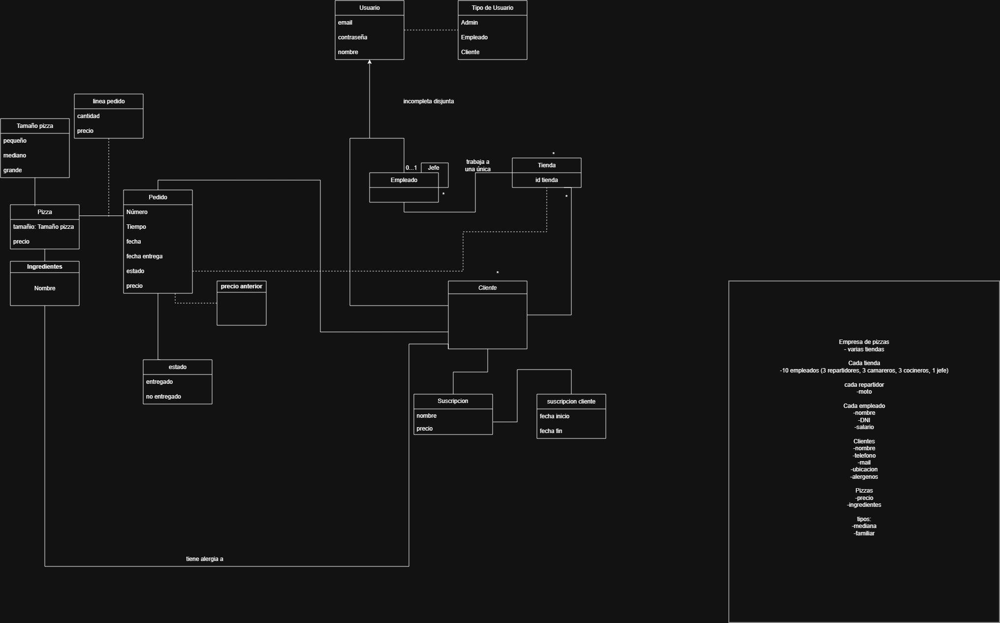
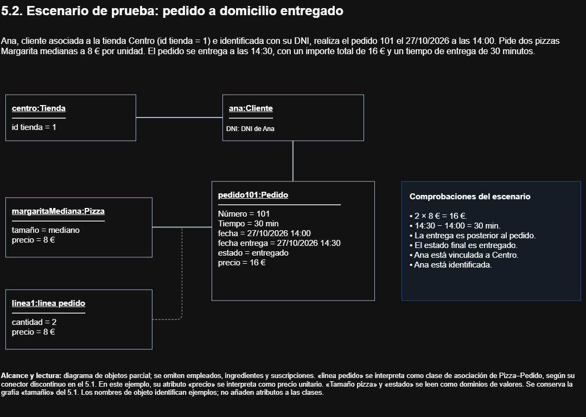

# Título Proyecto

Organización empresa de pizzas

## Miembros del grupo L11-XXX-X

1. Pineda Muñoz, Alfonso
2. Tejada González, Gonzalo
3. León Ramos, Mario

## 1. Introducción al problema

Somos una empresa de pizzerías con servicio a domicilio y consumo en tienda, la cual tiene diferentes tiendas, cada una asignada a una ubicación con un código postal distinto. La dirección de cada tienda está formada por su dirección exacta y su código postal. Cada tienda cuenta con una plantilla de 10 personas: 3 repartidores, 3 cocineros, 3 camareros y 1 jefe, cada empleado, incluido el jefe de tienda, pertenece a una única tienda.

Hay 3 tipos de usuarios: admin, cliente y empleado. (Hay diferentes tipos de empleados: cocinero, repartidor y camarero).

Para realizar pedidos en línea es necesario registrarse como cliente; para consumir en la tienda física no es necesario. Los clientes deben proporcionar su nombre, DNI y dirección (dirección exacta y código postal) para poder realizar pedidos en línea. A través de la ubicación del cliente, se le asociará la tienda cuyo código postal se encuentre más cerca de su ubicación. Los pedidos de la tienda física no se asocian a ningún cliente y se identifican únicamente por su número de pedido, ya que no se dispone de más información; son registrados por los camareros.

El pedido contiene varios atributos: número, tiempo (tiempo total de entrega), fecha (fecha en la que se realiza el pedido), fechaEntrega (fecha real de entrega), estado, precio y tipo (en línea o en tienda). El estado puede ser en preparación, en reparto, entregado o no entregado (si surge cualquier inconveniente). Los pedidos en tienda no tienen cliente, repartidor ni fecha de entrega, y no pasan por el estado en reparto. De cada pedido se registra el cocinero que lo prepara y, en los pedidos en línea, el repartidor que lo entrega.

Los clientes pueden pedir pizzas del catálogo de la empresa, y las hay de 3 tamaños: pequeña, mediana y grande. Cada pizza tiene un precio base distinto para cada tamaño, que puede ser modificado puntualmente; cuando esto ocurre, se guarda el precio anterior, ya que se supone un cambio temporal y el precio base volverá a su valor. Los clientes podrán eliminar de una pizza del catálogo los ingredientes a los que sean alérgicos; no se registran las alergias del cliente.

Además, los clientes podrán contar con una suscripción que le otorgará prioridad sobre los no suscritos a la hora de la entrega y la elaboración de sus pizzas. Solo existe un tipo de suscripción y un cliente solo puede tener una activa.

La función del administrador es controlar cada cuenta de usuario, sea empleado (y todos los tipos de empleado) o jefe.

## 2. Glosario de términos

## 3. Visión general del sistema
      
### 3.1. Requisitos generales
En este proyecto nos centraríamos en la gestión de poder permitir a los clientes realizar su pedido de pizza es decir la organización de la pizzeria para que les sea cómodo y sencillo a los clientes. Permitiendole a los mismos poder elegir tamaño e ingredientes.
También necesitaríamos un control de entregas e historial, para registrar los tiempos de preparación, fecha y estado del envío (entregado / no entregado), manteniendo trazabilidad de precios anteriores ante posibles cambios en la tarifa.  
Se debería también mantener una gestión de la estructura organizativa. Administrar las distintas sucursales/tiendas físicas, la asignación de la plantilla (repartidores, camareros, cocineros y jefes) y los recursos asociados (motos para reparto).  
La seguridad y perfiles de acceso. Disponer de un sistema de autenticación único para todos los usuarios que restrinja las funcionalidades según el rol o tipo de usuario asignado. 
Y por ultimo la gestión de alérgenos y fidelización. Poder registrar las alergias asociadas a cada cliente para prevenir incidentes de salud alimentaria y gestionar planes de suscripción para clientes habituales. 

### 3.2. Usuarios del sistema
Dentro de los usuarios del sistema nos encontraríamos al Administrador que su desempeño sería controlar que todo funcione correctamente ser el que decide si cambia algo del catalogo de las tiendas, y el que controla a los distintos usuarios ya que es el que tiene mayor privilegios en la plataforma.
Después vendrían los empleados que dentro de estos estarían: Los cocineros que necesitarían los respectivos ingredientes y serían los que cambian el estado del pedido, los siguientes serian los camareros que tendrían que estar pendientes del cliente y del pedido para repartirlo en la tienda y por ultimo estarían los repartidores que necesitarían una moto para poder repartir el pedido y de ellos dependería la actualización de la entrega del pedido. 
Por ultimo estarían los clientes que serían los que ordenan a la tienda lo que quieren eligiendo en el catalogo la pizza y el tamaño.

## 4. Catálogo de requisitos

### 4.1. Requisitos funcionales

#### R.F.01. Consulta del catálogo de pizzas
Como cliente quiero consultar el catálogo de pizzas disponibles, incluyendo sus ingredientes, tamaños y precios, para poder elegir los productos que mejor se adapten a mis preferencias.

**Pruebas de aceptación**

- El sistema deberá mostrar las pizzas disponibles en el catálogo.
- Cada pizza deberá mostrar su nombre y sus ingredientes.
- Se deberán mostrar los tamaños disponibles y el precio vigente de cada uno, teniendo en cuenta las modificaciones temporales activas.
- Si no existen pizzas disponibles, el sistema deberá mostrar un listado vacío.

##### R.F.02. Consulta de ingredientes de una pizza

Como cliente quiero consultar los ingredientes de una pizza para conocer su composición antes de realizar un pedido.

**Pruebas de aceptación**

- Se deberá poder seleccionar una pizza del catálogo.
- El sistema deberá mostrar los ingredientes que componen la pizza seleccionada.
- Se deberá mostrar la información sobre los alérgenos asociados a sus ingredientes.
- La consulta deberá corresponder únicamente a la pizza seleccionada.

##### R.F.03. Consulta del historial de pedidos

Como cliente quiero consultar mis pedidos anteriores para conocer los productos solicitados, sus importes y sus estados.

**Pruebas de aceptación**

- El sistema deberá mostrar los pedidos asociados al cliente identificado.
- Cada pedido deberá mostrar su identificador, fecha, importe total y estado.
- Se deberá poder consultar el detalle de las líneas de cada pedido, incluyendo cantidades y precios aplicados.
- Un cliente no podrá consultar los pedidos pertenecientes a otros clientes.
- Si el cliente no ha realizado pedidos, se mostrará un listado vacío.

##### R.F.04. Consulta de pedidos pendientes de una tienda

Como empleado quiero consultar los pedidos pendientes de mi tienda para conocer cuáles deben prepararse o entregarse.

**Pruebas de aceptación**

- El sistema deberá mostrar los pedidos de la tienda a la que pertenece el empleado.
- Se mostrarán únicamente los pedidos en los estados «en preparación» y «en reparto», excluyendo los estados «entregado» y «no entregado».
- Se podrá consultar el detalle de las líneas de cada pedido, incluyendo pizzas, tamaños, cantidades e ingredientes que se solicita retirar.
- Si no existen pedidos pendientes, se mostrará un listado vacío.
- Cada pedido deberá mostrar su número identificativo, fecha, estado y productos solicitados.
- No deberán aparecer pedidos de otras tiendas.

##### R.F.05. Consulta del estado de un pedido

Como cliente quiero consultar el estado actual de un pedido para conocer si ha sido entregado o continúa pendiente.

**Pruebas de aceptación**

- El cliente deberá poder seleccionar uno de sus pedidos.
- El sistema deberá mostrar el estado actual del pedido seleccionado.
- Se deberá mostrar la fecha de entrega cuando esté registrada.
- El sistema no deberá mostrar información de pedidos pertenecientes a otros clientes.

##### R.F.06. Listado de empleados de una tienda

Como jefe de tienda quiero consultar los empleados de una tienda para conocer su plantilla y distribución por categorías profesionales.

**Pruebas de aceptación**

- Como jefe de tienda quiero consultar la plantilla de mi tienda para conocer sus integrantes y sus funciones.
- La consulta corresponderá a la tienda del jefe de tienda identificado.
- Se deberá mostrar el nombre y la categoría profesional de cada empleado.
- El sistema deberá mostrar los empleados asociados a esa tienda.
- Se deberá identificar al jefe de tienda responsable de la tienda.

##### R.F.07. Consulta de empleados por categoría

Como jefe de tienda quiero consultar los empleados de mi tienda por categoría para conocer quiénes desempeñan cada función.

**Pruebas de aceptación**

- Se deberá poder seleccionar una categoría: cocinero, repartidor o camarero.
- El sistema deberá mostrar los empleados de la tienda del jefe de tienda identificado que pertenezcan a la categoría seleccionada.
- Se deberá mostrar el nombre y la categoría de cada trabajador.
- No deberán aparecer empleados de otras tiendas ni de otras categorías.
- Si no existen empleados que cumplan las condiciones, se mostrará un listado vacío.

##### R.F.08. Consulta de pedidos asignados a un repartidor

Como repartidor quiero consultar los pedidos de reparto que tengo asignados para conocer cuáles debo entregar y su estado actual.

**Pruebas de aceptación**

- El sistema deberá mostrar los pedidos asignados al repartidor identificado.
- Cada pedido deberá mostrar su número, fecha, dirección de entrega y estado.
- No deberán aparecer pedidos asignados a otros repartidores.
- No deberán aparecer pedidos realizados para consumo en tienda.
- Si el repartidor no tiene pedidos asignados, se mostrará un listado vacío.

##### R.F.09. Consulta de suscripciones de un cliente

Como cliente quiero consultar mis contrataciones de suscripción para conocer sus periodos de vigencia y comprobar si tengo una activa.

**Pruebas de aceptación**

- El sistema deberá mostrar las suscripciones asociadas al cliente identificado.
- Cada registro deberá mostrar las fechas de inicio y finalización de la contratación.
- Si el cliente nunca ha contratado una suscripción, se mostrará un listado vacío.
- Se deberá indicar si la suscripción está vigente en la fecha de consulta.
- Se deberán poder consultar también las suscripciones finalizadas.
- No deberán aparecer suscripciones de otros clientes.

##### R.F.10. Listado de pedidos por tienda y fecha

Como jefe de tienda quiero consultar los pedidos realizados en mi tienda durante un periodo determinado para conocer su actividad.

**Pruebas de aceptación**

- Se deberá poder seleccionar un intervalo de fechas. La consulta se limitará a la tienda del jefe de tienda identificado.
- El sistema deberá mostrar los pedidos de esa tienda cuya fecha de realización esté dentro del periodo seleccionado, incluyendo ambos días completos.
- Cada resultado deberá mostrar el número de pedido, su fecha, importe total y estado.
- No deberán aparecer pedidos de otras tiendas ni de fechas fuera del intervalo indicado.
- La fecha inicial no podrá ser posterior a la fecha final.
- Se incluirán tanto los pedidos en línea como los pedidos para consumo en tienda.
- Si no existen pedidos que cumplan las condiciones, se mostrará un listado vacío.

##### R.F.11. Consulta de suscriptores activos

Como jefe de tienda quiero consultar los clientes asociados a mi tienda que tienen una suscripción vigente para conocer quiénes disponen de sus ventajas.

**Pruebas de aceptación**

- Se deberá mostrar un listado de clientes asociados a la tienda del jefe de tienda identificado con suscripciones vigentes en el momento de la consulta.
- Se deberá mostrar el identificador y nombre del cliente, junto con las fechas de inicio y finalización de su suscripción.
- No deberán aparecer clientes cuyas suscripciones hayan finalizado o todavía no hayan comenzado.
- Cada cliente deberá aparecer una única vez.
- Si no existen suscriptores activos, se mostrará un listado vacío.

##### R.F.12. Consulta de pizzas por tamaño y precio

Como cliente quiero consultar las pizzas disponibles filtradas por tamaño y precio para encontrar las opciones que mejor se adapten a mis preferencias.

**Pruebas de aceptación**

- Se deberá poder seleccionar uno de los tres tamaños disponibles.
- Se deberá poder establecer un precio máximo.
- El sistema deberá mostrar las pizzas del tamaño seleccionado cuyo precio vigente no supere el máximo indicado, teniendo en cuenta las modificaciones temporales activas.
- Cada resultado deberá mostrar el nombre de la pizza, su tamaño y su precio vigente.
- Si ninguna pizza cumple las condiciones, se mostrará un listado vacío.

#### 4.1.1. Requisitos de información

A continuación se describen los requisitos de información necesarios para el funcionamiento del sistema de gestión de la empresa de pizzas. Cada requisito identifica la información que debe almacenar o proporcionar el sistema, el usuario que la necesita y las pruebas de aceptación que permiten comprobar su cumplimiento.

##### R.I.01. Información de usuarios:

Como administrador quiero almacenar la información de los usuarios del sistema para poder identificarlos y gestionar sus permisos de acceso.

**Prueba de aceptación**

- Cada usuario deberá tener un correo electrónico, un nombre y una contraseña.
- El correo electrónico deberá permitir identificar de forma única a cada usuario.
- Se deberá almacenar el tipo de usuario al que pertenece cada persona.
- Se deberá poder distinguir entre administradores, empleados y clientes.

##### R.I.02. Información de clientes:

Como cliente quiero almacenar mi información personal para poder identificarme en el sistema y realizar pedidos.

**Prueba de aceptación**

- Cada cliente deberá estar asociado a un usuario del sistema.
- Se deberán registrar y poder consultar el nombre, DNI, dirección exacta y código postal del cliente.
- El DNI deberá ser único entre los clientes.
- Se deberá identificar la tienda asignada a cada cliente.
- No se almacenarán las alergias del cliente.
- Un cliente podrá realizar varios pedidos.
- Se deberá poder identificar qué pedidos pertenecen a cada cliente.

##### R.I.03. Información de ingredientes retirados

Como cocinero quiero conocer los ingredientes que se solicita retirar de cada pizza pedida para prepararla conforme a lo solicitado.

**Prueba de aceptación**

-Se deberán registrar los ingredientes que se solicite retirar de cada línea de pedido.
-Una línea podrá tener ninguno, uno o varios ingredientes retirados.
-Los ingredientes retirados deberán pertenecer a la composición base de la pizza seleccionada.
-Todas las unidades de una misma línea compartirán los ingredientes retirados.
-Las pizzas con diferentes personalizaciones deberán registrarse en líneas distintas.
-La retirada de ingredientes no modificará la composición de la pizza en el catálogo.

##### R.I.04. Información de tiendas:

Como jefe de tienda quiero almacenar la información de las tiendas para poder identificar los establecimientos de la empresa y conocer sus trabajadores.

**Prueba de aceptación**

- Cada tienda deberá tener un identificador único.
- Cada tienda tiene una dirección exacta y código postal, este código postal puede ser único o no en caso que haya dos tiendas en el mismo barrio.
- Se deberán registrar la dirección exacta y el código postal de cada tienda.
- Se deberá poder conocer qué empleados trabajan en cada tienda.
- Se deberán poder identificar los clientes asignados a cada tienda y todos sus pedidos, tanto en línea como para consumo en tienda.
- No podrán existir dos tiendas con el mismo código postal.
- Se deberá identificar al jefe de tienda responsable de cada tienda.

##### R.I.05. Información de empleados:

Como jefe de tienda quiero almacenar la información de los empleados para conocer los trabajadores de cada tienda y gestionar su distribución.

**Prueba de aceptación**

- Cada empleado deberá estar asociado a un usuario del sistema.
- Cada empleado deberá pertenecer a una única tienda.
- Cada empleado deberá tener una única categoría: cocinero, repartidor o camarero.
- Se deberá poder consultar el identificador, nombre, categoría y tienda de cada empleado.
- Se deberá poder conocer el número de empleados de cada tienda.
- Se deberá poder consultar la información de los empleados de una tienda determinada.

##### R.I.06. Información de los jefes de las tiendas:

Como jefe de tienda quiero disponer de la información sobre la responsabilidad de las tiendas para identificar quién supervisa cada establecimiento y su plantilla.

**Prueba de aceptación**

- Cada jefe de tienda deberá estar asociado a un usuario del sistema.
- Cada jefe de tienda deberá pertenecer a una única tienda.
- Cada tienda deberá tener un único jefe de tienda.
- Se deberán poder identificar los empleados de la tienda bajo su responsabilidad.
- El jefe de tienda se distinguirá de las categorías de empleado: cocinero, repartidor y camarero.

##### R.I.07. Información de pizzas

Como jefe de tienda quiero almacenar la información de las pizzas ofrecidas por la empresa para mantener registrados los productos disponibles en el catálogo.

**Pruebas de aceptación**

- Cada pizza deberá tener un identificador único y un nombre.
- Se deberá almacenar la composición base de cada pizza mediante su relación con los ingredientes.
- Una pizza podrá estar compuesta por varios ingredientes.
- Un mismo ingrediente podrá formar parte de distintas pizzas.
- Se deberá registrar el precio establecido para cada combinación de pizza y tamaño.

##### R.I.08. Información de ingredientes

Como jefe de tienda quiero almacenar la información de los ingredientes utilizados en las pizzas para mantener registrada su composición y sus posibles alérgenos.

**Pruebas de aceptación**

- Cada ingrediente deberá tener un identificador único y un nombre.
- Un ingrediente podrá formar parte de varias pizzas.
- Una pizza podrá contener varios ingredientes.
- Se deberán almacenar las relaciones entre los ingredientes y los alérgenos que contienen.
- Un mismo alérgeno podrá estar presente en varios ingredientes.

##### R.I.09. Información de pedidos

Como jefe de tienda quiero almacenar la información de los pedidos en línea y para consumo en tienda para mantener un registro de las operaciones de mi establecimiento.

**Pruebas de aceptación**

- Cada pedido deberá tener un número identificativo único.
- Se deberá almacenar la fecha y hora de realización del pedido.
- Se deberá almacenar el importe total correspondiente al pedido.
- Cada pedido deberá estar asociado a una única tienda. Los pedidos en línea deberán estar asociados a un cliente registrado; los pedidos para consumo en tienda no tendrán cliente asociado.
- Se deberá registrar el estado del pedido.
- Se deberá almacenar la fecha y hora de entrega efectiva de los pedidos en línea entregados. Los pedidos para consumo en tienda no tendrán fecha de entrega.
- Se deberá conservar el importe aplicado al pedido, aunque posteriormente cambien los precios del catálogo.
- Se deberá registrar el tipo de pedido: en línea o para consumo en tienda.
- Los pedidos en línea deberán conservar la dirección exacta y el código postal de entrega aplicables al pedido, aunque posteriormente cambie la dirección del cliente.
- Se deberá identificar al cocinero responsable de preparar cada pedido cuando se le asigne.
- En los pedidos en línea se deberá identificar al repartidor responsable cuando se le asigne. Los pedidos para consumo en tienda no tendrán repartidor.
- Se deberá identificar al camarero que registre cada pedido para consumo en tienda.
- Los empleados asignados a un pedido deberán pertenecer a la tienda responsable de ese pedido.
- El tiempo total de entrega se obtendrá de la diferencia entre la fecha y hora de realización y la fecha y hora de entrega efectiva. No se calculará para pedidos sin entrega efectiva ni para pedidos de consumo en tienda.

##### R.I.10. Información de líneas de pedido:

Como cocinero quiero conocer las pizzas y cantidades incluidas en cada pedido para saber qué productos tengo que preparar.

**Prueba de aceptación**

- Cada línea de pedido deberá estar asociada a un pedido.
- Se deberá conocer la pizza y el tamaño correspondientes a cada línea de pedido.
- Se deberá almacenar la cantidad solicitada en cada línea, que será un número entero positivo.
- Se deberá conservar el precio unitario aplicado a cada línea. Su importe será el resultado de multiplicar ese precio por la cantidad solicitada.
- Cada pedido deberá contener al menos una línea.
- Cada línea deberá poder distinguirse de las demás líneas del mismo pedido.
- Se deberán poder consultar los ingredientes retirados de cada línea, según R.I.03.
- Todas las unidades de una misma línea compartirán pizza, tamaño, precio unitario e ingredientes retirados.
- El importe total del pedido será la suma de los importes de sus líneas.
- Los cambios posteriores de los precios del catálogo no modificarán los precios aplicados a las líneas ya registradas.

##### R.I.11. Información de estados de pedidos

Como jefe de tienda quiero almacenar los estados asociados a los pedidos para mantener registrada su situación durante el proceso de preparación y entrega.

**Pruebas de aceptación**

- Cada estado deberá disponer de un identificador único y una denominación.
- Los estados permitidos serán «en preparación», «en reparto», «entregado» y «no entregado».
- Cada pedido deberá tener asociado un estado actual.
- Se deberá conservar la relación entre cada pedido y su estado correspondiente.
- Los pedidos para consumo en tienda no podrán encontrarse en el estado «en reparto».
- En los pedidos para consumo en tienda, «entregado» indicará que el pedido se ha servido.
- El estado «no entregado» identificará un pedido finalizado sin haberse entregado o servido.

##### R.I.12. Información de tamaños de pizzas

Como jefe de tienda quiero almacenar los tamaños disponibles de las pizzas para mantener registradas las distintas opciones de venta y sus precios.

**Pruebas de aceptación**

- Cada tamaño deberá tener un identificador único y una denominación.
- Se deberán registrar tres tamaños: pequeño, mediano y grande.
- Se deberá almacenar la relación entre las pizzas y sus tamaños disponibles.
- Se deberá registrar el precio correspondiente a cada combinación de pizza y tamaño.

#### R.I.13. Información de precios de pizzas

Como jefe de tienda quiero disponer de los precios de cada pizza y tamaño para conocer la tarifa vigente y conservar el precio habitual ante modificaciones temporales.

**Pruebas de aceptación**

- Cada combinación de pizza y tamaño deberá tener un precio base.
- Se podrá registrar un precio temporal sin sobrescribir el precio base.
- Se deberá identificar si la modificación temporal está activa.
- El precio vigente será el temporal cuando la modificación esté activa y el precio base en caso contrario.
- Al finalizar la modificación temporal, se volverá a aplicar el precio base conservado.
- Los cambios de precio no modificarán los importes de los pedidos ya registrados.

##### R.I.14. Información de suscripciones de clientes

Como jefe de tienda quiero almacenar las contrataciones de suscripción de los clientes para conocer sus periodos de vigencia y conservar su historial.

**Pruebas de aceptación**

- Cada contratación deberá estar asociada a un cliente.
- Todas las contrataciones corresponderán al único tipo de suscripción existente.
- Se deberá almacenar la fecha y hora de inicio de cada contratación.
- Se deberá almacenar su fecha y hora de finalización de cada contratación.
- Un cliente podrá tener registradas varias suscripciones correspondientes a diferentes periodos.
- Se deberán conservar las suscripciones finalizadas como parte del historial de contrataciones.
- Cada contratación deberá tener un identificador único.
- El inicio de una contratación deberá ser anterior a su finalización.
- Una contratación estará vigente desde su inicio, incluido, hasta su finalización, excluida.
- Los periodos de las contrataciones de un mismo cliente no podrán solaparse.

#### 4.1.2. Reglas de negocio

##### R.N.01. Identificación de clientes 
La identificación de cada cliente tienen que ser distintas, no puede haber 2 DNIs iguales en el sistema

##### R.N.02. Advertencia por alergías:
Se debe bloquear la compra de determinadas pizzas si el cliente es alérgico a algún alimento

##### R.N.03. Límite de suscripciones 
Un usuario tan solo puede tener una suscripción activa ya que puedes estar o Suscrito\No suscrito por lo que solo se podría tener 1 suscripción

##### R.N.04. Exclusividad Jefe de tienda
Un empleado solo podría ser jefe en una tienda, y la tienda solo puede tener un jefe asignado.
Así mismo los empleados(cocinero, repartidor y camarero), solo podrían tener un jefe

##### R.N.05. Empleados -> Tienda
En cada tienda es obligatorio e independiente de las otras tiendas tener: 1 jefe de tienda, 3 repartidores, 3 cocineros y 3 camareros.

##### R.N.06. Una categoría 
Dentro del sistema cada empleado solo puede tener una categoría; si soy jefe no puedo ser cocinero, si soy camarero no puedo ser repartidor y así respectivamente con cada uno.

#### R.N.07. Priorización de pedidos de clientes suscritos
Los pedidos realizados por clientes con una suscripción activa tendrán prioridad frente a los pedidos de clientes no suscritos que aún no hayan comenzado a prepararse, tanto en la preparación como en la asignación para el reparto.

### 4.2. Mapa de historias de usuario (opcional)

### 4.3. Requisitos no funcionales (opcional)

**R.N.F. 01. Título requisito no funcional**
Como [tipo de usuario]
quiero [servicio]
para [razón]

-- fin entregable 1 --

## 5. Modelo conceptual

### 5.1. Diagramas de clases UML

[Archivo editable del modelo: se necesita abrir con draw.io](IISI1.drawio)

### 5.2. Escenarios de prueba

[Archivo editable del ejemplo: se necesita abrir con draw.io](Ejemplo_5_2_Pedido_Domicilio.drawio)

Se representa un escenario parcial de un pedido a domicilio entregado.
Ana, cliente asociada a la tienda Centro, realiza el pedido 101 el
27 de octubre de 2026 a las 14:00. Solicita dos pizzas Margarita
medianas a 8 € por unidad. El pedido se entrega a las 14:30,
con un importe total de 16 € y un tiempo de entrega de 30 minutos.

El diagrama muestra únicamente los objetos y enlaces relevantes
para este escenario.

## 6. Matrices de trazabilidad

Las matrices relacionan los requisitos de información y las reglas de
negocio con los elementos del modelo conceptual del apartado 5.1.

Una X indica que el elemento está relacionado con el requisito.
No implica que el requisito esté completamente representado.
Una celda vacía indica que no se señala una correspondencia directa.

**Clases y tipos del modelo**

| Requisito | US | TU | CL | TI | EM | PE | PI | IN | LP | TA | ES | SU | SC | PA |
|---|:---:|:---:|:---:|:---:|:---:|:---:|:---:|:---:|:---:|:---:|:---:|:---:|:---:|:---:|
| R.I.01 | X | X | | | | | | | | | | | | |
| R.I.02 | X | | X | X | | X | | | | | | | | |
| R.I.03 | | | | | | | X | X | X | | | | | |
| R.I.04 | | | X | X | X | X | | | | | | | | |
| R.I.05 | X | | | X | X | | | | | | | | | |
| R.I.06 | X | | | X | X | | | | | | | | | |
| R.I.07 | | | | | | | X | X | | X | | | | |
| R.I.08 | | | | | | | X | X | | | | | | |
| R.I.09 | | | X | X | X | X | | | X | | X | | | |
| R.I.10 | | | | | | X | X | X | X | X | | | | |
| R.I.11 | | | | | | X | | | | | X | | | |
| R.I.12 | | | | | | | X | | | X | | | | |
| R.I.13 | | | | | | X | X | | X | X | | | | X |
| R.I.14 | | | X | | | | | | | | | X | X | |
| R.N.01 | | | X | | | | | | | | | | | |
| R.N.02 | | | X | | | | X | X | | | | | | |
| R.N.03 | | | X | | | | | | | | | X | X | |
| R.N.04 | | | | X | X | | | | | | | | | |
| R.N.05 | | | | X | X | | | | | | | | | |
| R.N.06 | | | | | X | | | | | | | | | |
| R.N.07 | | | X | | | X | | | | | | X | X | |

**Leyenda**

- US: Usuario.
- TU: Tipo de Usuario.
- CL: Cliente.
- TI: Tienda.
- EM: Empleado.
- PE: Pedido.
- PI: Pizza.
- IN: Ingredientes.
- LP: linea pedido.
- TA: Tamaño pizza.
- ES: estado.
- SU: Suscripcion.
- SC: suscripcion cliente.
- PA: precio anterior.

**Asociaciones y restricciones representadas**

| Requisito | A1 | A2 | A3 | A4 | A5 | A6 | A7 | A8 | A9 | A10 | C1 |
|---|:---:|:---:|:---:|:---:|:---:|:---:|:---:|:---:|:---:|:---:|:---:|
| R.I.01 | | | | | | | | | | | |
| R.I.02 | X | X | | | | | | | | | |
| R.I.03 | | | | | | X | | | | | |
| R.I.04 | X | | X | X | | | | | | | X |
| R.I.05 | | | X | | | | | | | | |
| R.I.06 | | | X | X | | | | | | | X |
| R.I.07 | | | | | | X | | | X | | |
| R.I.08 | | | | | | X | | | | | |
| R.I.09 | | X | | | X | | | | | X | |
| R.I.10 | | | | | X | | | | X | | |
| R.I.11 | | | | | | | | | | X | |
| R.I.12 | | | | | | | | | X | | |
| R.I.13 | | | | | X | | | | X | | |
| R.I.14 | | | | | | | | X | | | |
| R.N.01 | | | | | | | | | | | |
| R.N.02 | | | | | | X | X | | | | |
| R.N.03 | | | | | | | | X | | | |
| R.N.04 | | | X | X | | | | | | | X |
| R.N.05 | | | X | | | | | | | | X |
| R.N.06 | | | | | | | | | | | |
| R.N.07 | | X | | | | | | X | | | |

**Leyenda**

- A1: asociación Cliente–Tienda.
- A2: asociación Cliente–Pedido.
- A3: asociación Empleado–Tienda.
- A4: asociación recursiva de Empleado con el rol Jefe.
- A5: asociación Pizza–Pedido, con «linea pedido» interpretada como clase de asociación.
- A6: asociación Pizza–Ingredientes.
- A7: asociación Cliente–Ingredientes, «tiene alergia a».
- A8: asociación Cliente–Suscripcion.
- A9: vinculación Pizza–Tamaño pizza.
- A10: vinculación Pedido–estado.
- C1: nota del modelo que establece diez empleados por tienda: un jefe, tres cocineros, tres repartidores y tres camareros.

**Observaciones sobre la cobertura**

- Las matrices reflejan correspondencias con el modelo actual; no certifican que todos los requisitos estén completos.
- R.I.02 y R.N.01: falta representar explícitamente el DNI del cliente y su unicidad.
- R.I.03: la asociación Pizza–Ingredientes permite conocer la composición, pero falta representar los ingredientes retirados de cada línea.
- R.I.04: deben completarse los datos de Tienda y resolverse la contradicción sobre la unicidad del código postal.
- R.I.05, R.I.06 y R.N.04–R.N.06: deben concretarse las categorías profesionales y sus restricciones. C1 recoge la composición de la plantilla en una nota, pero no sustituye su formalización.
- R.I.08: falta representar los alérgenos asociados a los ingredientes.
- R.I.09: deben aclararse la conexión Pedido–Tienda y las asignaciones de empleados, y completarse el tipo y los datos de entrega.
- R.I.10: deben precisarse la identificación de las líneas, el significado de su precio y las restricciones de cantidad e importe.
- R.I.11: el modelo muestra «entregado» y «no entregado»; faltan los otros estados definidos en los requisitos.
- R.I.12 y R.I.13: debe aclararse la representación de precios por pizza y tamaño, así como las modificaciones temporales.
- R.I.14 y R.N.03: debe aclararse la conexión de «suscripcion cliente» con la contratación y expresarse la prohibición de solapamiento entre periodos.
- R.N.02: la asociación «tiene alergia a» contradice los requisitos que excluyen almacenar las alergias del cliente.
- R.N.07: las asociaciones permiten relacionar clientes, pedidos y suscripciones, pero no expresan por sí solas la prioridad de preparación y reparto.

-- fin entregable 2 --
## 7. Modelo relacional en 3FN

- Relaciones obtenidas al aplicar la transformación del modelo conceptual.

### 7.1.  Justificación de la estrategia de transformación de jerarquías

- si se identificaron jerarquías en el MC.

### 8. Matriz de trazabilidad MC/SQL (opcional):

- Restricciones sobre el MC / Elementos del modelo tecnológico (SQL) (Triggers, checks, etc.)
- Incluir Reglas de negocio — Constraints/Triggers en las matrices de trazabilidad para el entregable 3

|       | EntidadX   | AsociaciónX  | RestricciónX  | Entidad2 ...   | 
|:-------|:-------|:-------|:-------|:-------|
| TABLA-1 |        |        |        |        |
| TABLA-2 |        |        |        |        |
| TABLA-3 |        |        |        |        |
| TABLA-4 |        |        |        |        |
| TRIG-1 |        |        |        |        |
| TRIG-2 | X      | X      |        | X      |
| TRIG-3 |        | X      |        | X      |
| TRIG-4 |        |        | X      |        |
| CONST-1 |        |        |        |        |
| CONST-2 | X      | X      |        | X      |
| CONST-3 |        | X      |        | X      |
| CONST-4 |        |        | X      |        |

Se consideran todo tipo de constraints declarativas (aquellas definidas durante el CREATE TABLE).
-- fin entregable 3 --

## Referencias

